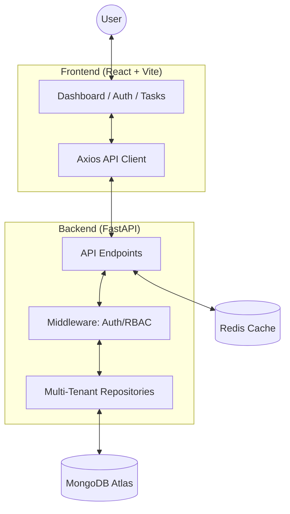

# TaskFlow: Multi-Tenant Task Management System

A production-grade, full-stack task management system featuring a **React** frontend and **FastAPI** backend. Designed for high scalability with multi-tenancy, RBAC, and immutable audit logging.

## 🏗️ Full-Stack Architecture

### System Design


### Core Technologies
- **Frontend**: React, Vite, Axios, React Router, Lucide Icons (Vercel)
- **Backend**: FastAPI, Motor, Pydantic v2 (Render + Docker)
- **Infrastructure**: Docker Compose, Nginx, MongoDB Atlas, Redis

---

## ✅ Features

- **Multi-Tenancy**: Strict data isolation at the repository layer using `organization_id`.
- **Role-Based Access Control (RBAC)**:
    - `Admin`: Full control over all tasks and users in the organization + Access to Activity Logs.
    - `Member`: Can only view and manage tasks assigned to them.
- **Authentication**: JWT-based auth with Refresh Token rotation.
- **Audit Logging**: Immutable tracking of every action (Create, Update, Delete) with before/after state snapshots.
- **Advanced Task Management**: Search, filtering (status, priority), and pagination.
- **Premium UI**: Modern dark-themed dashboard with glassmorphism and micro-animations.

---

## 🔒 Strict Multi-Tenant Isolation & RBAC

This system enforces a "Zero Leakage" policy through several layers of security:

### 1. Backend Isolation Layers
- **Tenant Isolation**: Every database query is automatically scoped with `WHERE organization_id = :org_id` at the repository level. This is impossible to bypass from the frontend.
- **RBAC Enforcement**: 
    - **Admin**: Has full access to all tasks and audit logs within their organization.
    - **Member**: Has restricted visibility. They can only see tasks where they are the **Creator** or the **Assignee**.
    - **Delete Permissions**: Members can only delete tasks they own (created or assigned). Deleting others' tasks results in a `403 Forbidden` error.

### 2. Demo Flow (How to Verify)

Follow these steps to prove the system's isolation:

**STEP 1: Seed Demo Data**
Run the seed script to create test organizations and users:
```bash
python seed_demo.py
```

Demo password for all accounts: `Password123!`

| Account | Role | Organization | Demonstrates |
|---|---|---|---|
| `admin_a@demo.com` | Admin | Organization A | Full tenant dashboard and audit logs |
| `member_a@demo.com` | Member | Organization A | Member permissions and assigned work |
| `admin_b@demo.com` | Admin | Organization B | Cross-tenant isolation |

The login page includes buttons to fill these demo credentials automatically.

**STEP 2: Test Multi-Tenancy (Cross-Org)**
1. Login as **Admin A** (`admin_a@demo.com`). You will see "Admin A Task" and "Task for Member A".
2. Login as **Admin B** (`admin_b@demo.com`). You will see **ZERO** tasks from Organization A. You only see "Secret Org B Task".

**STEP 3: Test RBAC (Member Limits)**
1. Login as **Member A** (`member_a@demo.com`).
2. You will see "Task for Member A" (assigned to you).
3. You **CANNOT** see "Admin A Task" (even though it's in your organization) because you are neither the creator nor the assignee.

**STEP 4: Test Audit Logs**
1. Navigate to the **Activity Logs** page as **Admin A**. You will see logs for tasks in Org A.
2. If you try to access the logs page as **Member A**, the UI will hide the link, and the API will return a `403 Forbidden`.

---

## 🚀 Quick Start (Docker Compose)

The entire system is containerized and can be started with a single command.

### 1. Prerequisites
- [Docker Desktop](https://www.docker.com/products/docker-desktop/) installed and running.

### 2. Environment Setup
```bash
cp .env.example .env
# Ensure JWT_SECRET_KEY is set to a secure string
```

### 3. Launch Services
```bash
docker-compose up --build -d
```

The local stack mirrors production: MongoDB and Redis run in containers and
the FastAPI service uses MongoDB through Motor. PostgreSQL is not required.

### 4. Access the App
- **Frontend**: [http://localhost:3000](http://localhost:3000)
- **Backend API Docs**: [http://localhost:8000/docs](http://localhost:8000/docs)

---

## 📽️ Demo Flow (Internship Validation)

Follow these steps to verify the core engineering principles of the system:

1.  **Register as Admin**:
    - Go to `/register` and create an account. This automatically creates a new **Organization**.
2.  **Create Tasks**:
    - Add a few tasks from the dashboard. Observe the status and priority filters.
3.  **View Activity Logs**:
    - Navigate to the **Activity Logs** page. You will see every action you just performed, including exact JSON diffs of what changed.
4.  **Verify Multi-Tenancy**:
    - Open an Incognito window and register a *second* user with a different email.
    - Notice that this user sees a completely empty dashboard. They cannot see tasks from your first organization.
5.  **Verify RBAC**:
    - (Optional) Manually change a user's role to `member` in the DB.
    - Log in as that user. The "Activity Logs" sidebar link will disappear, and they will only see tasks assigned specifically to them.

---

## 🔐 Security & Engineering Practices

### Tenant Isolation
Isolation is enforced at the repository layer, not the API layer. Every repository method takes an `organization_id` which is automatically injected from the JWT claims.
```python
# app/repositories/base.py
def __init__(self, model, db, organization_id):
    self.organization_id = organization_id
    # Every query is scoped by default
    self.base_query = select(model).where(model.organization_id == organization_id)
```

### Immutable Audit Trail
The `AuditLog` table uses a `CheckConstraint` to ensure actions are only `created`, `updated`, or `deleted`. The system records the IP address and User-Agent for every change.

## Cloud Deployment

### Render

Create a Render Web Service from this repository. Render can use
[`render.yaml`](./render.yaml) as a Blueprint. Set `MONGODB_URI` to the
MongoDB Atlas connection string and `ALLOWED_ORIGINS` to the deployed Vercel
URL. The service uses `/health` as its health check.

### Vercel

Import the `frontend` directory as the Vercel project root and set
`VITE_API_BASE_URL` to the public Render API URL. The root
[`vercel.json`](./vercel.json) keeps client-side React routes working on refresh.

### CI/CD

GitHub Actions runs the backend compile check and frontend production build on
every push and pull request. The deploy workflow can trigger provider deploys
after validation when `RENDER_DEPLOY_HOOK` and `VERCEL_DEPLOY_HOOK` repository
secrets are configured.

---

## 📚 Project Structure

```
task-management-system/
├── app/                # FastAPI Backend
│   ├── routes/         # API Endpoints (Auth, Tasks, Audit)
│   ├── models/         # SQLAlchemy Database Models
│   ├── schemas/        # Pydantic Data Validation
│   └── services/       # Business Logic (Audit Service)
├── frontend/           # React Frontend
│   ├── src/components/ # UI Components
│   ├── src/pages/      # View Components (Dashboard, Audit)
│   └── src/services/   # API Client (Axios)
├── docker-compose.yml  # Orchestration
└── README.md           # This documentation
```

---

## 👤 Author
**Software Engineering Intern**
NIT Tiruchirappalli | [GitHub](https://github.com/preet) | [LinkedIn](https://linkedin.com/in/preet)

---
**Built for excellence.**
"# multitenant" 
